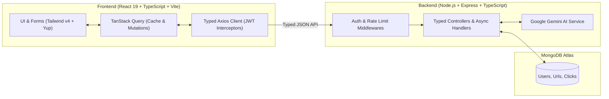

# URL Shortener Pro 🚀

> A modern, full-stack link management platform built from the ground up with **TypeScript**, featuring AI-powered link safety checks, smart custom aliases, real-time click analytics, and instant QR code generation.


---

## 🌐 Live Demo

* **Frontend (Vercel):** [https://url-shortener-pro-eta.vercel.app](https://url-shortener-pro-eta.vercel.app)
* **Backend API (Render):** [https://url-shortener-pro-5tlp.onrender.com](https://url-shortener-pro-5tlp.onrender.com)

---

## 🔷 Why TypeScript? (Simple Overview)

This project is written **100% in TypeScript** on both the frontend (`client`) and backend (`server`). TypeScript adds strict type checking on top of JavaScript, meaning bugs are caught at compile time before anyone runs the code.

Here is how TypeScript makes this project clean and reliable:
* **Clear Data Shapes (`types/`):** Interfaces like `IUser`, `IUrl`, and `IClick` define exact database models and API payloads so everyone knows what data looks like.
* **Typed Express Middlewares:** A custom `AuthRequest` interface safely attaches the logged-in user (`req.user`) to protected backend routes.
* **Smart Form Validation:** Uses **React Hook Form** + **Yup** (`yup.InferType`) so form rules and TypeScript types stay automatically in sync.
* **Typed API & Caching Layer:** Axios requests and **TanStack Query** hooks enforce exact response types across every component.
* **Zero Runtime Surprises:** Running `tsc` verifies the entire codebase—catching typos, missing fields, and `undefined` errors immediately.

---

## 🌟 Core Features

* **🔗 Fast URL Shortening & Custom Aliases:** Generates short 7-character codes with `nanoid` (with collision checks) or accepts custom human-readable slugs.
* **🛡️ AI Safety Shield (Google Gemini):** Automatically scans every destination URL before shortening to block phishing, scam, or malicious links.
* **✨ AI Smart Aliases & Insights:** Suggests relevant short slugs and generates plain-English performance summaries for your links.
* **📊 Real-Time Click Analytics:** Uses **MongoDB Aggregation Pipelines** (`$match`, `$group`, `$sort`) to break down clicks by browser, referrer source, and masked visitor IP activity.
* **⚡ Smooth Server State (TanStack Query):** Handles API caching, background updates, smooth pagination (`placeholderData`), and automatic list refreshes (`invalidateQueries`) after changes.
* **📱 Instant Dynamic QR Codes:** Generates downloadable high-resolution QR codes directly from shortened links.
* **🔒 Secure Auth & Protection:** Password hashing with `bcryptjs`, stateless JWT authentication, HTTP `302` redirects for accurate tracking, link expiration (`410 Gone`), and IP-based rate limiting.

---

## 🏗️ How It Works



---

## 📂 Project Structure

```text
url-shortener-pro/
├── client/                         # React + TypeScript Frontend
│   ├── src/
│   │   ├── api/                    # Axios setup (axios.ts) & QueryClient (queryClient.ts)
│   │   ├── components/             # Reusable UI (ProtectedRoute.tsx, ErrorFallback.tsx)
│   │   ├── context/                # Global auth state (AuthContext.tsx)
│   │   ├── hooks/                  # Custom hooks (useAnalytics.ts, useAiFeatures.ts, useQrCode.ts)
│   │   ├── pages/                  # App pages (Dashboard, Login, Register, NotFound, ServerError)
│   │   ├── services/               # Typed API calls (authService.ts, urlService.ts, aiService.ts)
│   │   ├── types/                  # Frontend TypeScript interfaces (index.ts)
│   │   ├── utils/                  # Yup validation schemas & inferred types (validationRules.ts)
│   │   ├── App.tsx                 # Route definitions
│   │   └── main.tsx                # Application entry point
│   ├── package.json
│   ├── tsconfig.json
│   └── vite.config.ts
│
├── server/                         # Node.js + Express + TypeScript Backend
│   ├── config/                     # MongoDB connection (db.ts)
│   ├── controllers/                # Business logic (authController.ts, urlController.ts, aiController.ts)
│   ├── middlewares/                # Auth, Error Handler, Rate Limiter, Validator
│   ├── models/                     # Typed Mongoose schemas (User.ts, Url.ts, Click.ts)
│   ├── routes/                     # Express routers (index.ts, authRoutes.ts, urlRoutes.ts, aiRoutes.ts)
│   ├── services/                   # Google Gemini AI integration (aiService.ts)
│   ├── types/                      # Backend TypeScript interfaces (IUser, IUrl, IClick, AuthRequest)
│   ├── utils/                      # Helpers (asyncHandler.ts, generateShortCode.ts, generateToken.ts)
│   ├── app.ts                      # Express server entry point
│   ├── package.json
│   └── tsconfig.json
│
└── README.md
```

---

## 🔌 API Endpoints

| Category | Method | Endpoint | Description | Auth |
| :--- | :--- | :--- | :--- | :--- |
| **Auth** | `POST` | `/auth/register` | Register a new account | No |
| **Auth** | `POST` | `/auth/login` | Log in & receive JWT token | No |
| **URLs** | `POST` | `/urls` | Create short URL (Rate limited & AI checked) | Yes |
| **URLs** | `GET` | `/urls` | Get paginated links with search filtering | Yes |
| **URLs** | `PUT` | `/urls/:id` | Update original destination URL | Yes |
| **URLs** | `DELETE` | `/urls/:id` | Soft-delete a link | Yes |
| **URLs** | `GET` | `/urls/:id/qrcode` | Generate QR code data URL | Yes |
| **AI** | `POST` | `/ai/aliases` | Generate AI custom alias suggestions | Yes |
| **AI** | `POST` | `/ai/insights` | Generate AI analytics insights | Yes |
| **Public** | `GET` | `/:shortCode` | `302` Redirect + log browser/IP/referrer | No |
| **Public** | `GET` | `/stats/:shortCode` | Fetch aggregated click analytics | No |
| **Health** | `GET` | `/health` | API uptime & health check | No |

---

## 🚀 Getting Started

### Prerequisites
* **Node.js** (v18+)
* **MongoDB** (Local or MongoDB Atlas URI)
* **Google Gemini API Key** ([Google AI Studio](https://aistudio.google.com/))

### 1. Start the Backend (`server`)

```bash
cd server
npm install
```

Create a `.env` file inside `server/`:
```env
PORT=5000
NODE_ENV=development
MONGO_URI=your_mongodb_connection_string
JWT_SECRET=your_jwt_secret_key
JWT_EXPIRES_IN=7d
CLIENT_URL=http://localhost:5173
GEMINI_API_KEY=your_gemini_api_key
```

Run the backend:
```bash
npm run dev      # Development server with live reload (tsx watch)
npm run build    # Type-check & compile TypeScript to dist/
npm start        # Run server with tsx
```

### 2. Start the Frontend (`client`)

```bash
cd ../client
npm install
```

Create a `.env.development` file inside `client/`:
```env
VITE_API_URL=http://localhost:5000
```

Run the frontend:
```bash
npm run dev       # Start Vite dev server
npm run typecheck # Run TypeScript type check (tsc --noEmit)
npm run lint      # Run Oxlint linter
npm run build     # Type-check & build production bundle
```

---

## 🛡️ License

Licensed under the [MIT License](LICENSE).
