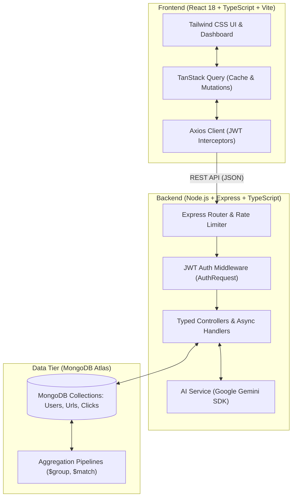

# URL Shortener Pro 🚀

> A modern, full-stack, type-safe link management platform featuring AI-powered safety verification, smart alias generation, real-time click stream analytics, and dynamic QR code creation.


---

## 🌐 Live Deployments

* **Frontend Client (Vercel):** [https://url-shortener-pro-eta.vercel.app](https://url-shortener-pro-eta.vercel.app)
* **Backend API (Render):** [https://url-shortener-pro-5tlp.onrender.com](https://url-shortener-pro-5tlp.onrender.com)

---

## 🌟 Key Features

### 🛡️ 1. AI Safety Shield & Smart Aliases (Google Gemini)
* **Malicious URL Detection:** Every submitted long URL is proactively analyzed by Google Gemini AI before creation to block phishing, malware, scams, and deceptive domains.
* **AI Smart Aliases:** Automatically suggests catchy, contextual custom slugs based on destination content.

### 📊 2. High-Performance Click Analytics
* **MongoDB Aggregation Pipelines:** Clicks are processed natively inside MongoDB (`$group`, `$sum`, `$sort`) for sub-millisecond analytics generation.
* **Granular Insights:** Breaks down traffic by browser family, referral sources (Google, Twitter, Direct), click volume, and masked visitor IP activity.
* **Temporary HTTP 302 Redirection:** Ensures browsers do not permanently cache routes, guaranteeing accurate click tracking on every visit.

### ⚡ 3. Optimized Asynchronous Server State (TanStack Query)
* **Intelligent Caching:** Eliminates unnecessary API network round-trips.
* **Smooth Pagination:** Leverages `placeholderData: (previousData) => previousData` to keep tables steady between page changes without full-page loading spinners.
* **Declarative Cache Invalidation:** Auto-refreshes URL lists seamlessly using `queryClient.invalidateQueries({ queryKey: ['urls'] })` on create, edit, and delete mutations.

### 🔒 4. Enterprise-Grade Security & Reliability
* **End-to-End TypeScript:** Complete compile-time type safety across database schemas, API controllers, Axios services, and React UI components.
* **JWT Authentication & Bcrypt:** Secure user registration, password hashing with salt rounds, and token expiration handling.
* **Custom Typed Middleware:** `AuthRequest` interface binds strongly-typed user documents to Express request handlers.
* **Rate Limiting:** Protects URL creation endpoints against spam bots and DDoS attacks via `express-rate-limit`.
* **Link Expiration:** Supports configurable expiry dates, serving an informative HTTP 410 Expired notice when links reach their lifespan.
* **Dynamic QR Codes:** Instant high-resolution QR codes generated on-demand for every shortened link.

---

## 🏗️ System Architecture



---

## 📂 Project Structure

```text
url-shortener-pro/
├── client/                     # Frontend Single Page Application
│   ├── src/
│   │   ├── api/                # QueryClient configuration
│   │   ├── components/         # Shared UI components (ProtectedRoute, ErrorFallback)
│   │   ├── hooks/              # Custom hooks (useAnalytics, useAiFeatures, useQrCode)
│   │   ├── pages/              # Pages (Dashboard, Login, Register, NotFound, ServerError)
│   │   ├── services/           # Typed Axios services (authService, urlService, aiService)
│   │   ├── types/              # Frontend TypeScript interfaces and models
│   │   ├── App.tsx             # Route definitions
│   │   └── main.tsx            # Entry point with QueryClientProvider & AuthProvider
│   ├── package.json
│   ├── tsconfig.json
│   └── vite.config.ts
│
├── server/                     # Backend REST API Service
│   ├── config/                 # Database connection (Mongoose)
│   ├── controllers/            # Request handlers (authController, urlController, aiController)
│   ├── middlewares/            # Auth, Error Handling, Rate Limiter, Validator
│   ├── models/                 # Mongoose Schemas (User, Url, Click)
│   ├── routes/                 # Express route definitions
│   ├── services/               # External integrations (Google Gemini AI)
│   ├── types/                  # Backend TypeScript interfaces (IUser, IUrl, IClick, AuthRequest)
│   ├── utils/                  # Helpers (asyncHandler, generateShortCode, generateToken)
│   ├── app.ts                  # Express application setup
│   ├── package.json
│   └── tsconfig.json
│
└── README.md
```

---

## 🔌 API Endpoints Summary

### Authentication (`/auth`)
| Method | Endpoint | Description | Auth Required |
| :--- | :--- | :--- | :--- |
| `POST` | `/auth/register` | Register a new user | No |
| `POST` | `/auth/login` | Authenticate user & receive JWT | No |

### Link Management (`/urls`)
| Method | Endpoint | Description | Auth Required |
| :--- | :--- | :--- | :--- |
| `POST` | `/urls` | Create short URL (Rate limited, AI checked) | Yes |
| `GET` | `/urls` | Fetch paginated user URLs with search | Yes |
| `PUT` | `/urls/:id` | Update target destination URL | Yes |
| `DELETE` | `/urls/:id` | Soft-delete shortened URL | Yes |
| `GET` | `/urls/:id/qrcode`| Generate base64 QR code image | Yes |

### AI Features (`/ai`)
| Method | Endpoint | Description | Auth Required |
| :--- | :--- | :--- | :--- |
| `POST` | `/ai/aliases` | Generate creative alias recommendations | Yes |
| `POST` | `/ai/insights`| Generate AI performance summary for link | Yes |

### Public Routing & Analytics
| Method | Endpoint | Description | Auth Required |
| :--- | :--- | :--- | :--- |
| `GET` | `/:shortCode` | 302 Redirect to destination + Click logging | No |
| `GET` | `/stats/:shortCode`| Retrieve aggregated click statistics | No |
| `GET` | `/health` | Server uptime & health status check | No |

---

## 🚀 Getting Started

### Prerequisites
* **Node.js**: v18.0.0 or higher
* **MongoDB**: A running local instance or MongoDB Atlas URI
* **Gemini API Key**: From [Google AI Studio](https://aistudio.google.com/)

---

### 1. Backend Setup

```bash
cd server
npm install
```

Create a `.env` file in `server/`:
```env
PORT=5000
NODE_ENV=development
MONGO_URI=your_mongodb_connection_string
JWT_SECRET=your_jwt_secret_key
JWT_EXPIRES_IN=7d
CLIENT_URL=http://localhost:5173
GEMINI_API_KEY=your_google_gemini_api_key
```

Run in development mode (powered by `tsx`):
```bash
npm run dev
```

Build for production:
```bash
npm run build
npm start
```

---

### 2. Frontend Setup

```bash
cd ../client
npm install
```

Create a `.env.development` file in `client/`:
```env
VITE_API_URL=http://localhost:5000
```

Run Vite development server:
```bash
npm run dev
```

Build and test production preview:
```bash
npm run build
npm run preview
```

---

## 🛡️ License

This project is licensed under the [MIT License](LICENSE).
